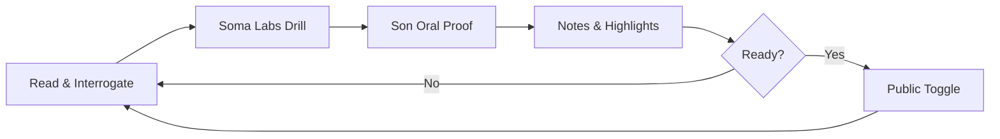
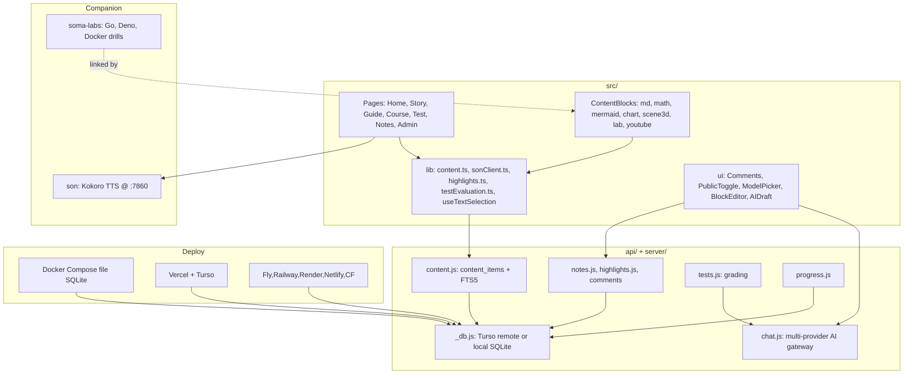
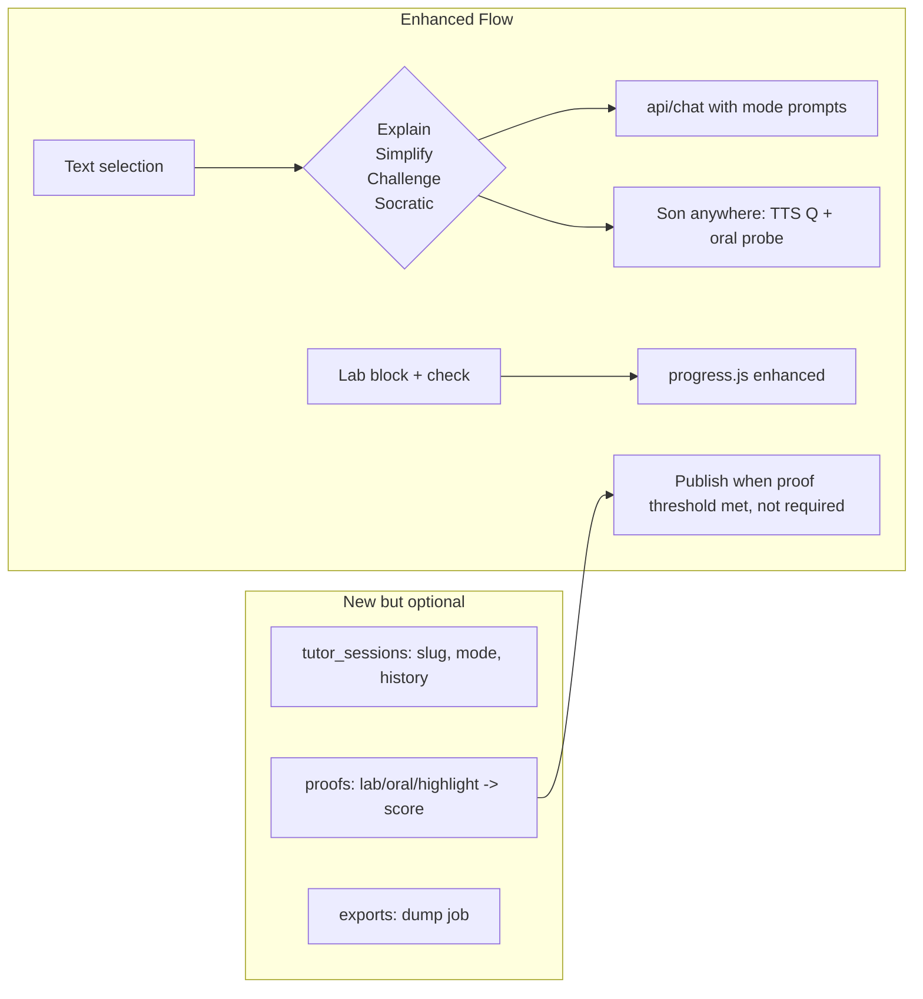

# SOMA: Product Vision & Architecture Manifesto
**AI-Accelerated Learning You Own — The North Star**

> *"Think in private on your own terms, prove your understanding out loud, and make public what you wish."*

Date: 2026-11-09
Status: Draft — source of truth for product direction

---

## 1. The Core Thesis: Reversing the Atrophy of Thought

Generative AI made producing content trivial and retaining it rare. People read summaries, copy snippets, paste into voids, and mistake convenience for comprehension. Illusion of competence is at an all-time high. Retention is at an all-time low.

**Soma reverses this.**

We don't replace human cognition. We use AI as an aggressive, high-friction cognitive multiplier that turns passive consumption into active mastery. Learning feels like evening coffee: warm, inviting, low-pressure, entirely for you, yet backed by rigorous multi-modal proof.

---

## 2. What Soma Is Today (Honest Audit)

After reading `src/types`, `api/*`, `src/lib/*`, `src/pages/*`, `SOMA_SKILL.md`, and the three-repo design:

**What works:**
- **Content engine**: 10 types (story, guide, course, book, series, doc, featured, test, podcast, topic) with 12 block primitives (paragraph, image, code, math/KaTeX, mermaid, chart/Recharts, 3D/Three, youtube, callout, videoCallout, lab). Generic typed manuscripts, not bundled prose.
- **Store + visibility**: Runtime Turso/local SQLite store (`api/content.js` + `api/_db.js`), FTS5 search, private-by-default, instant public toggle. `drafts/` -> validate -> publish-private -> owner flips public -> archive to `src/content/`. Forks stay public, writing stays private.
- **Deploy matrix**: Docker Compose (file SQLite), Dockerfile (Fly/Railway/Render/Coolify), Vercel + Turso, Netlify Functions, Cloudflare Pages. `USE_TURSO` flag cleanly separates local vs remote. Real multi-target.
- **Agent-native authoring**: MCP server `server/mcp-server.mjs` (10 tools) + Soma Skill + Opinionation Skill. Any agent can draft, validate (`npx tsx scripts/validate-content.ts`), publish private, verify URLs. Content never touches git until explicitly archived.
- **Learning primitives v0**: Margin highlights (`api/highlights.js`), threaded comments with AI replies (`api/chat.js`), notes (`/learn`), Son oral tests (`src/lib/sonClient.ts`, `TestPage.tsx`) with Kokoro TTS prefetch cache, lab blocks pointing to `soma-labs`.
- **Model gateway**: `api/models.js` + `api/chat.js` — DeepSeek, OpenRouter (curated set), Gemini (translated to OpenAI SSE), Groq, Cerebras, Straitly. One key lights up margin AI + test grading.

**What is narrative vs implemented:**
- **Margin AI** today is select-any-paragraph -> explain. Vision wants *interrogate* mode: challenge, simplify, counter-argue, socratic — as a tutor sitting next to you. The chat API supports system prompts, but there's no tutor persona state, no difficulty slider, no session memory per reading position.
- **Soma Labs** today is a `lab` block with path/command/output. Vision wants runnable drills in-browser or one-click local. There is no sandbox runtime, no progress binding, no pass/fail wired to content.
- **Son** today powers `/tests/:slug` only, with fallback to text. Vision wants conversational testing everywhere — any paragraph, any guide, on demand. No global oral mode.
- **SaaS vs Sovereign**: Code is fully sovereign (Docker/local file = true own-your-brain). There is no Stripe/entitlement layer, no hosted multi-tenant SaaS. "Managed SaaS" is just "deploy my fork to Vercel" today.
- **Prove it loop**: No unified proof graph. Tests grade answers, but highlights, notes, lab runs, and oral scores don't roll up into "I understand X."

This doc closes those gaps without throwing away what works.

---

## 3. The Product Pillars (Vision → Architecture)

### Pillar I: Sovereign by Default (Own Your Brain)

**Problem**: Learning tools hold thoughts hostage in proprietary clouds.

**Soma solution today**: Open-source at `essomero/soma`, edge DB (Turso remote or local SQLite via `SQLITE_PATH`), notes/highlights/comments/content_items tables owned by you. One file backup (`/app/data/soma.db`). No telemetry.

**What stays**: File SQLite path remains first-class. Docker Compose stays the 60s demo. `api/_db.js` `getMode()` / `parseUseTurso()` abstraction stays — it's the sovereignty boundary.

**Hardening required**:
- Export: `GET /api/export` -> zip of `soma.db` + markdown dump of all content_items + highlights + notes. True own-your-brain needs an eject button.
- Encryption at rest toggle for local file (SQLCipher option behind env).
- Git-ignored `drafts/` stays private; archive under `src/content/` is explicit public history only.

### Pillar II: Managed SaaS (Zero Friction)

**Problem**: Self-hosting is freedom with friction.

**Soma solution**: A hosted tier where you open a tab and start thinking.

**Architecture**:
```
User -> soma.mayanja.dev (or self-hosted) -> /api/* -> libSQL remote (Turso)
                                      \
                                       -> local SQLite if USE_TURSO=false
```

SaaS is not a separate codebase. It's the same binary (`server/index.mjs`, `api/`) with:
- Auth: `SITE_PASSWORD` today is single-owner. SaaS needs org-less single-user auth first (magic link + device sessions), then optional workspaces. Keep password mode as self-host default.
- Entitlements: Free forever for self-host. Hosted adds usage meter on AI calls (via `api/chat.js`), storage, and Son-cloud (if we ever host Son).
- No code fork: Same types, same content store, same FTS5. SaaS is deploy config, not a product split.

**Decision**: Don't build multi-tenant immediately. Ship hosted single-user with Turso + Vercel as reference SaaS. Add billing only when retention loop proves fun.

### Pillar III: Learn It, Prove It, Publish It

This is the core loop. Today it's linear: read -> maybe highlight -> maybe test. Vision wants a cycle.



#### a) Margin AI — Read & Interrogate

Current: `useTextSelection` -> `Comments.tsx` -> `api/chat.js` -> streams answer.

Target: Margin tutor with modes and memory.

- **Modes** in the selection popover: Explain / Simplify / Challenge / Counter-example / Socratic. Each maps to a system prompt template stored in `src/lib/admin-prompts.ts` (we extend it).
- **Session memory**: Per-page reading session (not global chat) that holds selected paragraph + prior tutor turns, keyed by `content_items.slug` + section_index. Cheap — store in `comments` table with `is_ai=1` already exists, just add `mode` and `selection_context`.
- **ModelPicker**: Already supports per-provider models. Add preferred tutor model pin per user.

Small change, big feel. No new tables day one — just remix existing comments/highlights.

#### b) Soma Labs — Interactive Drills

Current: Lab block = title + path + command.

Target: Drills that run where reader is, then proof attaches.

Phase 1 (no infra): Lab block gets `expected_output` regex + `check_command`. Frontend runs nothing, but `TestPage`/guide can call `npm run` locally and paste output — evaluation via `src/lib/testEvaluation.ts` already grades.

Phase 2: Browser sandbox for TS/JS/SQL drills via WebContainers or local eval for safe languages. Keep Go/Docker drills as local clone (`soma-labs` repo link) — don't try to run Go in browser.

Phase 3: Progress binding — `api/progress.js` already exists. Extend to `{ slug, lesson_id, lab_id, status: 'attempted'|'passed', attempts }`. Drill status rolls up to course completion.

Key: Don't build a code runner before proof loop feels delightful. Use existing `lab` block shape + progress.

#### c) Son Voice Agent — Spoken Verification

Current: `sonClient.ts` has URL resolution, `checkSonAvailability()`, prefetch cache keyed by `questionAudioCacheKey`, speech cleaning, speak via `/speak`.

Target: Son anywhere, not just `/tests/:slug`.

- Already have barge-in, Kokoro voices, `OralQuestionAudio.tsx`, `OralAnswerInput.tsx`.
- Add global command: "Ask Son about this" in margin popover -> synthesizes paragraph explanation + asks oral check question generated by `api/tests.js` LLM grading path.
- Keep Son optional: `checkSonAvailability()` probe keeps text fallback. Don't couple voice to reading path — degrade silently.
- Son stays independent repo. Soma just drives its `/speak` + STT frontend. Local remains `http://localhost:7860`, configurable via localStorage `son_backend_url`.

#### d) Public Toggle — Publish When Ready

Current: `PublicToggle.tsx` + `api/content.js` status enum `private|published` + owner guard `isAuthed`. Works.

Vision-aligned polish:
- Private notebook (`/learn` + `/notes`) should show proof summary: X drills passed, Y oral proofs, Z highlights. Then toggle says "you've proved this — publish?"
- Archive step: `npm run publish-all.ts` already copies private rows to `src/content/` TS for git history. Keep it. It's the paper trail of public mind.

---

## 4. Experience: Evening Coffee, Not School

Non-negotiables from vision:

- **No grade-grind**: No streaks, no XP, no dark patterns. Progress is a quiet private checkmark, not a billboard.
- **Curiosity-driven**: Drop any source — research paper, blueprint, classic lit — agent skill pipeline converts to Soma page. `manuscript_template` tool already scaffolds all types. Add `import` command: paste URL/PDF -> agent drafts manuscript via MCP `publish_manuscript`.
- **Conversational testing**: Son oral test feels like chat with sharp friend, not interrogation. That means less scoring speech, more "say it better" nudges. `testEvaluation.ts` should have friendly mode.

**Design guardrails** (already in CLAUDE.md / AGENTS.md):
- Grokking tone: intuition before vocab, pain first, real stakes (payment gateways, race conditions, packet drops), never `foo/bar`.
- Typography: Sora/DM Sans/KaTeX, wide margins, napkin visuals. Mermaid, chart, 3D are already lazy-loaded — keep bundles lean.
- Private-first UI: Public toggle exists but never shouts.

---

## 5. Architecture Map (Today → Next)



**Next layer (doesn't break current):**



---

## 6. Road Ahead — Phased, No Regrets

### Phase 0: Solidify Sovereign Export (1-2 days)
- `GET /api/export` zip: `soma.db` + markdown dump + assets list
- Add to `/admin` menu. Docs in README.
- Why first: Own-your-brain promise must be provable.

### Phase 1: Margin Tutor Modes (2-3 days)
- Extend `admin-prompts.ts` with 5 mode prompts
- Update selection popover in `Comments.tsx` / `useTextSelection.ts` to show modes
- Store mode in `comments.ai_model` field or add `mode` col — reuse existing table first
- Stream via existing `api/chat.js`, no new API
- Son optional TTS for tutor answer: reuse `prefetchQuestionAudio` / `synthesizeSpeechWithSon`

### Phase 2: Proof Graph v0 (3-5 days)
- Enhance `progress.js` to track lab runs + oral scores + highlights count per slug
- UI in `/learn` and private page header: quiet summary "3 drills · 2 oral proofs · 12 notes"
- No gating — just visibility. Publishing remains one click.

### Phase 3: Labs Runner v0.5 (1 week)
- Improve `lab` block renderer: show expected vs got, check command
- Add `check` button that evaluates via `testEvaluation.ts` for JS/TS/SQL
- Document local flow for Go/Docker via `soma-labs` clone (already in guides)

### Phase 4: Import Anything (1 week)
- MCP tool enhancement: `verify_url` already exists
- New agent workflow: paste paper URL / PDF / YouTube -> MCP drafts manuscript in `drafts/<type>/` -> `validate_manuscript` -> `publish_manuscript` private
- Conversion lives in skill instruction, not code — just better prompts

### Phase 5: Hosted SaaS Thin Layer (when loop proves fun)
- Single-user hosted = current Vercel+Turso with auth polish (magic link via existing `auth.js`)
- Meter AI calls from `chat.js` logs
- Keep `SITE_PASSWORD` path as self-host default — no fork

---

## 7. What We Will Not Build (Anti-Goals)

- **Notion clone**: No databases, no kanban for learning. Notebook is markdown studio + typed content via `/admin`.
- **LMS**: No assignments, no due dates, no cohort mechanics. Private first.
- **Code runner as moat**: Don't host Go/Docker sandboxes. Browser-eval only for safe drills. Real engineering runs locally in `soma-labs`.
- **Second content system**: Everything still goes through `content_items` + FTS5 + same blocks. No parallel note graph.
- **Multi-tenant before single-user delight**: SaaS is config, not rewrite.

---

## 8. Success Criteria — "Evening Coffee Test"

A new user can:
1. `docker compose up` or click deploy on Vercel, login, start reading in <60s
2. Select a hard paragraph, ask Margin AI to challenge them, have a back-and-forth that leaves them clearer (not just answered)
3. Run a drill with their own hands and see progress reflected
4. Speak an explanation out loud to Son and get a nudge, not a grade
5. Decide this is worth sharing, flip one toggle, and have a beautiful public page with no move to another tool
6. Export everything as zip + markdown in one click and walk away

If it doesn't feel like evening coffee, we overbuilt.

---

## 9. Open Questions

- **Son everywhere**: Should oral proof be ambient (always available) or explicit (button)? Start explicit — ambient risks annoyance.
- **Proof threshold**: Should publish suggest proof completeness? Soft nudge yes, hard gate no. Sovereign means you publish when you want.
- **SaaS billing**: Wait for signal. Free self-host forever. Hosted free tier same. Paid only if AI costs justify.
- **Companions**: Keep three-repo split (`soma`, `soma-labs`, `son`). Monorepo would betray sovereign simplicity.

---

## 10. References

- Current types: `src/types/index.ts`
- Content store: `api/content.js`, `api/_db.js`
- AI gateway: `api/chat.js`, `api/models.js`
- Reading UX: `src/lib/useTextSelection.ts`, `src/components/ui/Comments.tsx`, `src/lib/highlights.ts`
- Son client: `src/lib/sonClient.ts`
- Tests: `src/pages/TestPage.tsx`, `api/tests.js`
- Publishing: `server/mcp-server.mjs`, `SOMA_SKILL.md`, `scripts/publish-content.ts`
- Deploy: `docker-compose.yml`, `Dockerfile`, `api/`, `netlify/functions/`, `functions/api/`

Build for thinkers who want to own their brain, not rent attention.
