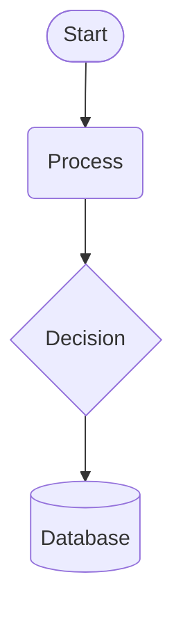
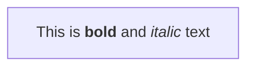
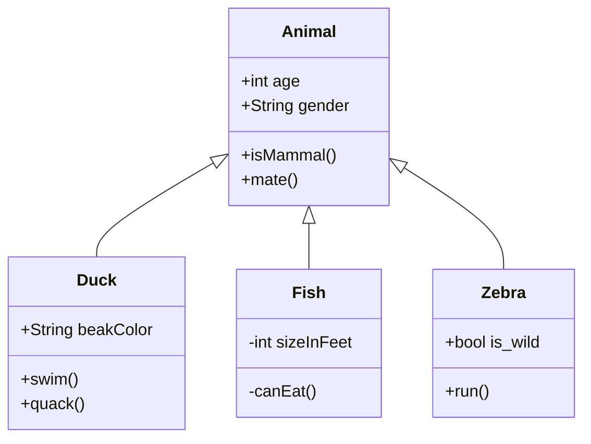
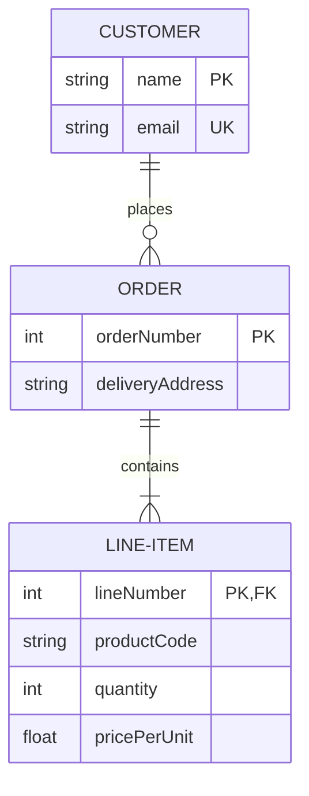
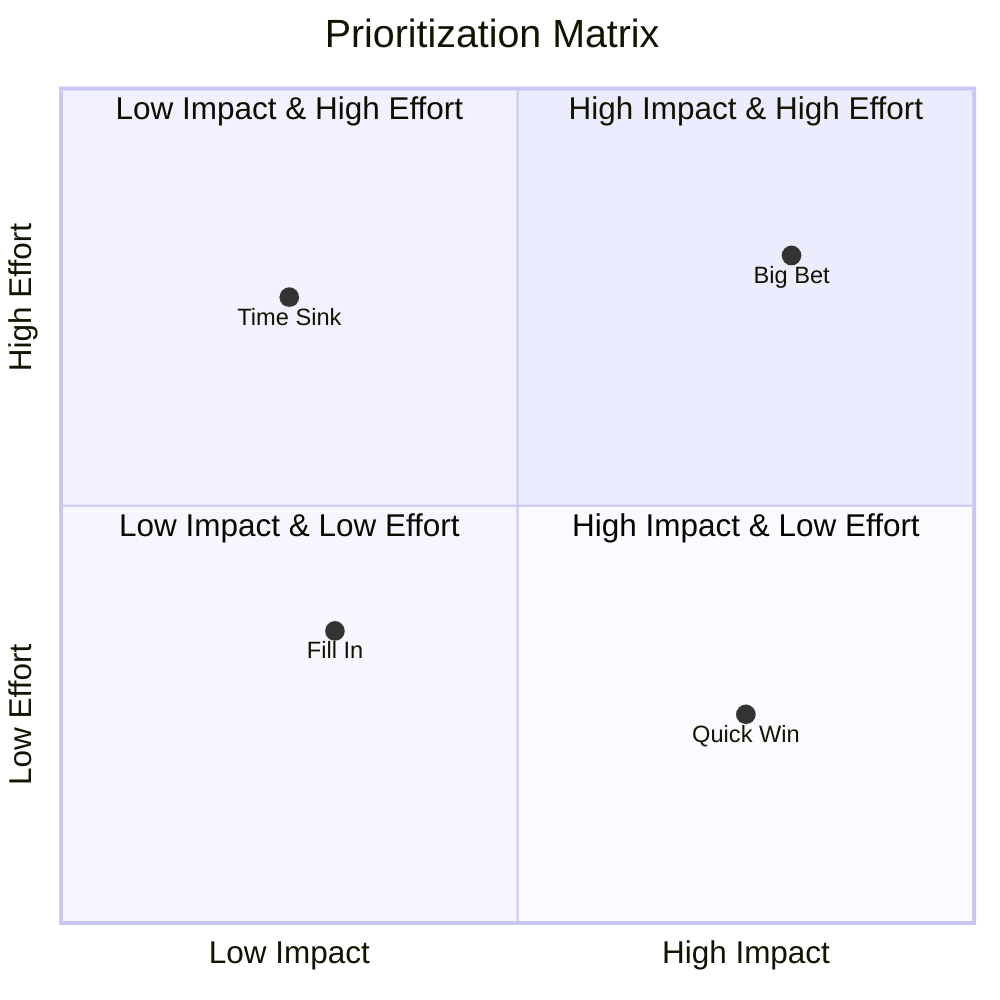
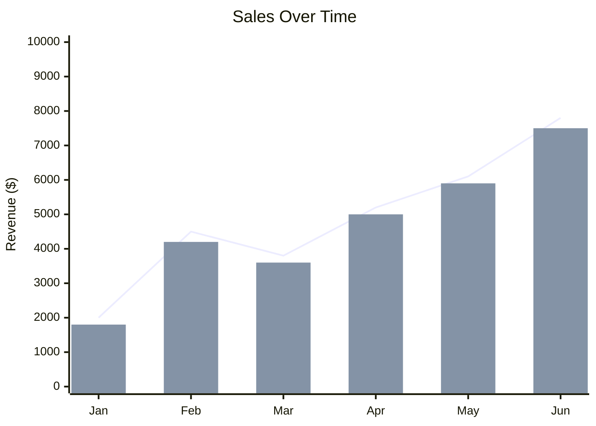
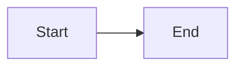
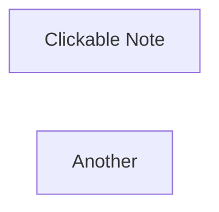

---
tags:
  - reference
  - mermaid
  - diagrams
  - obsidian
date: 2026-06-28
aliases:
  - Mermaid Reference
  - Mermaid Syntax Guide
languages:
  - mermaid
  - yaml
  - javascript
cssclasses:
  - reference
---

# Mermaid — Full Reference for Obsidian

> [!abstract] Scope
> Every diagram type Mermaid supports, with syntax, shapes, config, and examples — current as of June 2026 (Mermaid v11.x). Focused on what works **inside an Obsidian code block**.

## Diagram Catalog (30 Types)

### Stable

| Type | What It Draws |
|------|---------------|
| **Flowchart** | Nodes and edges for process flows, decisions, data paths |
| **Sequence** | Time-ordered interactions between participants/actors |
| **Class** | UML classes, interfaces, attributes, methods, relationships |
| **State** | Finite state machines with transitions and events |
| **ER Diagram** | Database entities, attributes, keys, and relationships |
| **User Journey** | Step-by-step UX map across phases with scores |
| **Gantt** | Horizontal bar chart for project scheduling |
| **Pie Chart** | Proportional circular/donut chart |
| **Quadrant Chart** | 2×2 grid for prioritization/analysis |
| **Requirement** | Requirements, their types, and traceability links |
| **GitGraph** | Git branch, merge, commit history |
| **Mindmap** | Hierarchical radial layout for brainstorming |
| **Timeline** | Chronological sequence of events |
| **ZenUML** | Lightweight text-based sequence diagram |
| **Swimlanes** | Flowchart variant with lane-separated actors |

### Experimental / Caution

| Type | Status | What It Draws |
|------|--------|---------------|
| **C4 Diagram** | 🦺⚠️ Experimental | Software architecture: Context, Container, Component, Code |

### New & Hot (🔥)

| Type | What It Draws |
|------|---------------|
| **Sankey** | Flow diagram — arrow width proportional to quantity |
| **XY Chart** | Line, bar, scatter on Cartesian axes |
| **Block Diagram** | System-level blocks with full layout control |
| **Packet** | Network packet header/payload structure |
| **Kanban** | Agile board with columns and cards |
| **Architecture** | High-level system architecture component map |
| **Radar** | Multi-variable spider/radar chart |
| **Event Modeling** | Event-driven system timelines and projections |
| **Treemap** | Hierarchical data as nested proportional rectangles |
| **Venn** | Set intersection/union as overlapping circles |
| **Ishikawa** | Fishbone / cause-and-effect diagram |
| **Wardley** | Strategic value-chain map (evolution × visibility) |
| **Cynefin** | Sense-making: Clear, Complicated, Complex, Chaotic, Disorder |
| **TreeView** | Collapsible hierarchical tree |

---

## 1 — Flowchart

The workhorse. Nodes (shapes) connected by edges (links).

### Direction

```
flowchart TD    Top → Bottom (same as TB)
flowchart BT    Bottom → Top
flowchart LR    Left → Right
flowchart RL    Right → Left
```

### Classic Node Shapes

| Shape | Syntax | Notes |
|-------|--------|-------|
| Rectangle | `A["Text"]` | Default |
| Rounded | `A("Text")` | Round edges |
| Stadium (pill) | `A(["Text"])` | Terminal points |
| Subroutine | `A[["Text"]]` | Framed |
| Cylinder | `A[("Text")]` | Database |
| Circle | `A(("Text"))` | Start/stop |
| Asymmetric | `A>Text]` | Flag-like |
| Rhombus | `A{Text}` | Decision |
| Hexagon | `A{{Text}}` | Prepare conditional |
| Parallelogram | `A[/Text/]` | Input/output |
| Alt parallelogram | `A[\Text\]` | |
| Trapezoid | `A[/Text\]` | Priority action |
| Alt trapezoid | `A[\Text/]` | Manual operation |
| Double circle | `A(((Text)))` | Stop |

### Expanded Node Shapes (`A@{ shape: name }` syntax, v11.3.0+)

**Process & Standard:**

| Shape | Short Name | Shape | Short Name |
|-------|-----------|-------|-----------|
| Rectangle | `rect` | Rounded | `rounded` |
| Stadium | `stadium` | Framed Rect | `fr-rect` |
| Diamond | `diam` | Hexagon | `hex` |
| Trap-Base-Bottom | `trap-b` | Trap-Base-Top | `trap-t` |
| Delay (half-rounded) | `delay` | Divided Rect | `div-rect` |
| Lined Rect | `lin-rect` | Tagged Rect | `tag-rect` |

**Data & Storage:**

| Shape | Short Name | Shape | Short Name |
|-------|-----------|-------|-----------|
| Cylinder | `cyl` | Data Store | `datastore` |
| Lean Right | `lean-r` | Lean Left | `lean-l` |
| Horizontal Cyl | `h-cyl` | Lined Cyl | `lin-cyl` |
| Bow Tie Rect | `bow-rect` | Window Pane | `win-pane` |

**Document:**

| Shape | Short Name | Shape | Short Name |
|-------|-----------|-------|-----------|
| Document | `doc` | Stacked Docs | `docs` |
| Lined Document | `lin-doc` | Tagged Document | `tag-doc` |
| Flag (Paper Tape) | `flag` | | |

**Start/Stop & Junction:**

| Shape | Short Name | Shape | Short Name |
|-------|-----------|-------|-----------|
| Circle | `circle` | Small Circle | `sm-circ` |
| Double Circle | `dbl-circ` | Framed Circle | `fr-circ` |
| Filled Circle | `f-circ` | Crossed Circle | `cross-circ` |

**Specialized:**

| Shape | Short Name | Shape | Short Name |
|-------|-----------|-------|-----------|
| Cloud | `cloud` | Bang | `bang` |
| Notched Rect | `notch-rect` | Hourglass | `hourglass` |
| Lightning Bolt | `bolt` | Curly Brace | `brace` |
| Brace Right | `brace-r` | Braces (both sides) | `braces` |
| Curved Trapezoid | `curv-trap` | Triangle | `tri` |
| Fork/Join | `fork` | Notch Pentagon | `notch-pent` |
| Flipped Triangle | `flip-tri` | Sloped Rect | `sl-rect` |
| Stacked Rect | `st-rect` | Odd | `odd` |
| Text Block | `text` | | |

**New shape example:**



### Icon and Image Shapes

```mermaid
flowchart TD
    A@{ icon: "fa:fa-user", form: "square", label: "User", pos: "t" }
    B@{ img: "https://example.com/icon.png", label: "Logo", w: 60, h: 60 }
```

### Links (Edges)

| Type | Syntax |
|------|--------|
| Arrow | `A --> B` |
| Open (no arrow) | `A --- B` |
| Text on link | `A -- text --> B` or `A -->|text| B` |
| Dotted | `A -.-> B` |
| Dotted with text | `A -. text .-> B` |
| Thick | `A ==> B` |
| Thick with text | `A == text ==> B` |
| Invisible | `A ~~~ B` |
| Circle edge | `A --o B` |
| Cross edge | `A --x B` |
| Bidirectional | `A <--> B` |

**WARNING:** If a node ID starts with `o` or `x`, add a space — otherwise `A --- oB` becomes a circle edge.

**Chaining:**

```
A --> B & C --> D          B and C both link from A, both link to D
A --> B --> C --> D        Sequential chain
```

**Minimum link length** — add extra dashes/dots/equals:

| Length | Normal | Arrow | Thick | Thick Arrow | Dotted | Dotted Arrow |
|--------|--------|-------|-------|-------------|--------|-------------|
| 1 | `---` | `-->` | `===` | `==>` | `-.-` | `-.->` |
| 2 | `----` | `--->` | `====` | `===>` | `-..-` | `-..->` |
| 3 | `-----` | `---->` | `=====` | `====>` | `-...-` | `-...->` |

Text on longer links: put extra characters on the **right** side — `A -- text --> B`

**Edge animation (v11.10.0+):**

```mermaid
flowchart LR
    e1@--> B
    e1@{ animate: true, animation: fast }
```

### Subgraphs

```
subgraph Title
    A --> B
end

subgraph id1 [Custom Label]
    C --> D
end
```

**Internal direction:**

```
flowchart LR
    subgraph TOP
        direction TB
        A --> B
    end
```

> If any node in a subgraph is linked outside, the subgraph direction is ignored.

### Markdown in Labels



Auto-wraps text. Disable in frontmatter:

```yaml
---
config:
  markdownAutoWrap: false
---
```

### FontAwesome Icons

```
B[fa:fa-twitter]
B(fab:fa-github)
```

Supported prefixes: `fa`, `fab`, `fas`, `far`, `fal`, `fad`, `fak`.

### Click Events (disabled under `securityLevel='strict'`)

```
click nodeId callback
click nodeId "https://url.com" "Tooltip" _blank
click nodeId call callback()
click nodeId href "https://url.com" "Tooltip"
```

### Styling

**Inline style:**

```
style A fill:#f9f,stroke:#333,stroke-width:4px
```

**Classes:**

```
classDef className fill:#f9f,stroke:#333,stroke-width:4px;
class nodeId1,nodeId2 className;
```

**Shorthand `:::`:**

```
A:::someClass --> B:::otherClass
classDef someClass fill:#f96
```

**Default class** (applies to all unstyled nodes):

```
classDef default fill:#f9f,stroke:#333,stroke-width:4px;
```

**Link styles** (by 0-indexed order number):

```
linkStyle 0 stroke:#ff3,stroke-width:4px;
linkStyle 1,2,7 color:blue;
```

### Line Curves

```yaml
---
config:
  flowchart:
    curve: stepBefore
---
```

Available: `basis`, `bumpX`, `bumpY`, `cardinal`, `catmullRom`, `linear`, `monotoneX`, `monotoneY`, `natural`, `step`, `stepAfter`, `stepBefore`.

Edge-level (v11.10.0+):

```
e1@--> B
e1@{ curve: stepBefore }
```

### Special Characters

Enclose in quotes: `A["Special: [](){}"]`

Entity codes with `#`: `#35;` → hash, `#62;` → greater-than

### `end` Reserved Word

Lowercase `end` breaks the flowchart. Capitalize: `End`, `END`, or use `[end]`.

---

## 2 — Sequence Diagram

### Participants

```
participant A as Alice
actor B as Bob
```

Actors render as stick figures; participants as boxes.

**Actor creation/destruction (v10.3.0+):**

```
create participant C
A --> C: Hello
destroy C
```

### Grouping with Boxes

```
box Aqua Group Description
  participant A
  participant B
end
box rgb(33,66,99)
  participant C
end
```

### Messages

| Arrow | Meaning |
|-------|---------|
| `->>` | Solid with arrowhead |
| `-->>` | Dotted with arrowhead |
| `->` | Solid, no arrow |
| `-->` | Dotted, no arrow |
| `<<->>` | Solid bidirectional (v11.0.0+) |
| `<<-->>` | Dotted bidirectional (v11.0.0+) |
| `-x` | Solid with cross end |
| `--x` | Dotted with cross end |
| `-)` | Solid with open arrow (async) |
| `--)` | Dotted with open arrow (async) |

**Half-arrows (v11.12.3+):**

| Arrow | Description |
|-------|-------------|
| `-\|` | Solid, top half arrowhead |
| `--\|` | Dotted, top half arrowhead |
| `-\|/` | Solid, bottom half arrowhead |
| `--\|/` | Dotted, bottom half arrowhead |
| `/\|-` | Solid, reverse top half arrowhead |
| `/\|--` | Dotted, reverse top half arrowhead |

### Activations

```
activate Alice
A -->> B: Message
deactivate Alice
```

Shortcut with `+`/`-`:

```
Alice ->>+ Bob: Start work
Bob -->>- Alice: Done
```

Activations stack — each `+` adds a layer.

### Notes

```
Note left of Actor: Text
Note right of Actor: Text
Note over Actor: Text
Note over Actor1, Actor2: Spanning text
```

### Control Flow

```
loop Every item
    A ->> B: Process
end

alt Success path
    A ->> C: Continue
else Failure path
    A ->> D: Abort
end

opt Optional step
    A ->> B: Maybe
end

par Action 1
    A ->> B: Do this
and Action 2
    A ->> C: Do that
end

critical Must complete
    A ->> B: Required
option Fallback A
    B ->> C: Plan B
option Fallback B
    B ->> D: Plan C
end

break Error condition
    A ->> B: Handle exception
end
```

### Background Highlight

```
rect rgb(0, 255, 0)
    A ->> B: Green zone
end
rect rgba(0, 0, 255, .1)
    C ->> D: Transparent blue
end
```

### autonumber

```
autonumber             1, 2, 3...
autonumber 10 5       10, 15, 20... (v11.15.0+)
```

### Actor Menus

```
link A: Dashboard @ https://dashboard.example.com
link A: Repo @ https://github.com/example/repo
```

Or JSON:

```
links A: {"Dashboard": "https://...", "Repo": "https://..."}
```

---

## 3 — Class Diagram

### Defining Classes

```
class Animal
class Animal["Custom Label"]
```

### Members

Colon syntax:

```
class BankAccount
BankAccount : +String owner
BankAccount : +deposit(amount) bool
```

Curly-brace syntax:

```
class BankAccount {
    +String owner
    +BigDecimal balance
    +deposit(amount) bool
    +withdrawal(amount) int
}
```

### Visibility

| Symbol | Meaning |
|--------|---------|
| `+` | Public |
| `-` | Private |
| `#` | Protected |
| `~` | Package / Internal |

### Member Classifiers

| Syntax | Meaning |
|--------|---------|
| `method()*` | Abstract method |
| `method()$` | Static method |
| `field$` | Static field |

### Generic Types

Use `~` tilde:

```
class Square~Shape~{
    int id
    List~int~ position
    getPoints() List~int~
}
```

### Relationships

| Type | Syntax | Meaning |
|------|--------|---------|
| Inheritance | `A <\|-- B` | B extends A |
| Composition | `A *-- B` | A owns B |
| Aggregation | `A o-- B` | A has B |
| Association | `A --> B` | A uses B |
| Dependency | `A ..> B` | A depends on B |
| Realization | `A ..\|> B` | A implements B |
| Solid link | `A -- B` | Undirected |
| Dashed link | `A .. B` | Undirected dashed |

**Labels:**

```
Animal <|-- Duck : inherits
Vehicle *-- Car : composed of
```

**Two-way relationships:**

```
A <|--|> B      bidirectional inheritance
A *--* B        bidirectional composition
```

**Lollipop interfaces:**

```
bar ()-- foo
foo --() bar
```

### Cardinality / Multiplicity

```
Customer "1" <--> "1..*" Order
```

| Notation | Meaning |
|----------|---------|
| `1` | Exactly one |
| `0..1` | Zero or one |
| `1..*` | One or more |
| `*` | Many |
| `0..*` | Zero or more |
| `n` | Exactly n (n > 1) |

### Annotations (Stereotypes)

```
class <<Interface>> MyClass
<<Abstract>> MyClass
<<Service>> MyClass
```

### Namespaces (v11.15.0+)

```
namespace BaseShapes {
    class Triangle
    class Rectangle {
        double width
        double height
    }
}

namespace BaseShapes["Base Shapes"] { ... }
namespace BaseShapes.Rectangle { ... }           dot notation
```

### Notes

```
note "General note"
note for ClassName "Line1\nLine2"
```

### Direction

```
classDiagram
direction RL
```

### Complete Example



---

## 4 — State Diagram

### Basic State

```
stateId
state "description" as stateId
stateId : description
```

### Transitions

```
[*] --> State       start
State --> [*]       end
State1 --> State2 : Label
```

### Composite States

```
state composite {
    inner1 --> inner2
}
```

Nesting works recursively.

### Special Nodes

| Type | Syntax |
|------|--------|
| Choice | `state s <<choice>>` |
| Fork | `state s <<fork>>` |
| Join | `state s <<join>>` |

### Concurrency

```
state concurrent {
    region1 --> region2
    --
    region3 --> region4
}
```

### Direction

```
direction LR
```

### Notes

```
note left of stateId : Note text
note right of stateId : Note text
```

### Styling

```
classDef styleName fill:#f9f,stroke:#333,stroke-width:4px
class stateName styleName
stateId:::styleName        inline shorthand
```

> Cannot style `[*]` or internal states of composites (as of current release).

---

## 5 — Entity Relationship Diagram (❗ experimental)

### Relationship Syntax

```
ENTITY_A [cardinality] [line-style] [cardinality] ENTITY_B : "label"
```

### Cardinality

| Left | Right | Meaning |
|------|-------|---------|
| `\|o` | `o\|` | Zero or one |
| `\|\|` | `\|\|` | Exactly one |
| `}o` | `o{` | Zero or more |
| `}\|` | `\|{` | One or more |

**Aliases:** `one or zero`, `one or more`, `zero or more`, `only one`, `1`, `1+`, `0+`, `many(0)`, `many(1)`

### Line Style

| Syntax | Meaning |
|--------|---------|
| `--` or `to` | Identifying (solid) |
| `..` or `optionally to` | Non-identifying (dashed) |

### Attributes

```
ENTITY {
    type name PK "comment"
    type name FK
    type name UK
    type name?              nullable (v11.16.0+)
}
```

- `PK` = Primary Key, `FK` = Foreign Key, `UK` = Unique Key
- `PK, FK` — composite key
- Comments in double quotes at end of attribute

### Entity Aliases

```
CUSTOMER [Customer] ||--o{ ORDER [Order] : places
```

### Direction

```
direction LR
```

### Full Example



---

## 6 — Gantt Chart

### Basic Structure

```
gantt
    title Project Plan
    dateFormat  YYYY-MM-DD
    axisFormat  %d-%b
    tickInterval 1week
    weekday monday
    excludes weekends
    excludes 2025-12-25

    section Section 1
    Task A           :done, a1, 2025-01-01, 30d
    Task B           :after a1, 20d
    Milestone        :milestone, m1, 2025-02-01, 0d

    section Section 2
    Task C           :crit, 2025-01-15, 12d
    Task D           :24d
```

### Task Metadata

Order matters: `[status], [id], [start/after], [end/length/until]`

| Field | Syntax |
|-------|--------|
| Status | `done`, `active`, `crit`, `milestone` (or combo: `done, crit`) |
| Start date | `2025-01-01` |
| Length | `30d` / `2w` / `1M` / `4h` / `30m` / `500ms` / `1y` / `1.5d` |
| After dependency | `after taskID` or `after taskA taskB` |
| Until | `until otherTaskID` (v10.9.0+) |
| Milestone | `milestone` tag + `0d` length |

### Directives

| Directive | Purpose |
|-----------|---------|
| `dateFormat YYYY-MM-DD` | How input dates are parsed (day.js format) |
| `axisFormat %d-%b` | How dates render on axis (d3 format) |
| `tickInterval 1week` | Axis tick spacing |
| `weekday monday` | Start day for week-based ticks |
| `excludes weekends` | Skip weekends |
| `excludes YYYY-MM-DD` | Skip specific dates or days |
| `weekend friday` | Which days are weekend (v11.0.0+) |
| `todayMarker off` | Hide today marker |

### Duration Units

| Unit | Suffix |
|------|--------|
| Milliseconds | `ms` |
| Seconds | `s` |
| Minutes | `m` |
| Hours | `h` |
| Days | `d` |
| Weeks | `w` |
| Months | `M` |
| Years | `y` |

### Vertical Markers

```
vert 2025-06-15
vert 2025-09-01
```

### Compact Mode

```yaml
---
displayMode: compact
---
```

### Bar Chart Trick

Use Gantt with 12 sequential months for a simple bar chart:

```
gantt
    title Monthly Revenue
    dateFormat YYYY-MM-DD
    axisFormat %b
    section 2025
    Jan :jan, 2025-01-01, 30d
    Feb :feb, after jan, 30d
    ...
```

---

## 7 — Pie Chart

```
pie showData title My Chart
    "Slice One" : 40
    "Slice Two" : 35
    "Slice Three" : 25
```

| Keyword | Effect |
|---------|--------|
| `showData` | Show numeric values next to legend |
| `title <text>` | Chart title |

### Config (v11.16.0+)

```yaml
---
config:
  pie:
    textPosition: 0.75
    donutHole: 0.4
    legendPosition: bottom
    highlightSlice: "Slice One"              or: 'hover'
---
```

| Parameter | Range | Default |
|-----------|-------|---------|
| `textPosition` | 0.0 – 1.0 | `0.75` |
| `donutHole` | 0 – 0.9 | `0` |
| `legendPosition` | `top`, `bottom`, `left`, `right`, `center` | `right` |
| `highlightSlice` | label string or `'hover'` | — |

> Values must be **positive, non-zero** numbers. Decimals to 2 places.

---

## 8 — Quadrant Chart



- Quadrants: 1 = top-right, 2 = top-left, 3 = bottom-left, 4 = bottom-right
- Point coordinates: **0 to 1** on both axes

### Point Styling

```
Point A: [0.9, 0.0] radius: 12
Point B: [0.8, 0.1] color: #ff3300, radius: 10, stroke-color: #10f0f0, stroke-width: 5px
Point C:::myClass: [0.7, 0.2]
classDef myClass color: #109060, radius: 10
```

| Parameter | Description |
|-----------|-------------|
| `color` | Fill color |
| `radius` | Point radius |
| `stroke-width` | Border width |
| `stroke-color` | Border color |

---

## 9 — GitGraph

```
gitGraph
   commit
   commit id: "c1" tag: "v1.0"
   branch develop
   checkout develop
   commit type: HIGHLIGHT
   commit type: REVERSE
   checkout main
   merge develop tag: "v1.1"
   commit
   cherry-pick id: "c1"
```

### Orientation

```
gitGraph LR:      left-to-right (default)
gitGraph TB:      top-to-bottom
gitGraph BT:      bottom-to-top (v11.0.0+)
```

### Commit Types

| Type | Visual |
|------|--------|
| `NORMAL` | Default circle |
| `HIGHLIGHT` | Filled rectangle |
| `REVERSE` | Crossed circle |

### Cherry-Pick

```
cherry-pick id: "target_commit_id"
```

- Target must be on a **different** branch
- Current branch must have ≥1 commit
- For merge commits, `parent: "PARENT_ID"` is mandatory

### Config Directives

```
%%{init: { 'gitGraph': { 'showBranches': false, 'mainBranchName': 'trunk' } } }%%
```

| Config | Default | Description |
|--------|---------|-------------|
| `showBranches` | `true` | Show branch labels |
| `showCommitLabel` | `true` | Show commit labels |
| `mainBranchName` | `"main"` | Rename main branch |
| `mainBranchOrder` | `0` | Main branch position |
| `rotateCommitLabel` | `true` | 45° or horizontal |
| `parallelCommits` | `false` | Level commits by distance from parent |

### Branch Ordering

```
branch feature-a order: 3
branch feature-b order: 1
branch feature-c order: 2
```

### Themes

`base`, `forest`, `dark`, `default`, `neutral`

---

## 10 — Mindmap

```
mindmap
    Root Topic
        Subtopic A
            Detail A1
            Detail A2
        Subtopic B
            Detail B1
            Detail B2
```

> Experimental. Syntax and properties may change.

### Shapes

```
id[Square]
id(Rounded)
id((Circle))
id))Bang((
id)Cloud(
id{{Hexagon}}
Plain text       default (rounded)
```

### Icons and Classes

```
Topic ::icon(fa fa-star)
Topic ::: urgent large
```

### Layout

```yaml
---
config:
  layout: tidy-tree
---
```

---

## 11 — Timeline

```
timeline
    title History of Computing
    section 1970s
        1971 : First microprocessor
        1976 : Apple I
    section 1980s
        1981 : IBM PC
        1984 : Macintosh
    section 1990s
        1991 : World Wide Web
             : Linux kernel
             : Python language
```

### Event Syntax Variants

```
1900 : Single event
1900 : Event A : Event B           two events on same line
1900 : Event A                     stacked events
     : Event B
```

### Direction (v11.14.0+)

```
timeline LR      left to right (default)
timeline TD      top to down
```

### Multi-color Control

```javascript
mermaid.initialize({
    timeline: {
        disableMulticolor: true,
    },
});
```

### Themes

`base`, `forest`, `dark`, `default`, `neutral`

---

## 12 — User Journey

```
journey
    title My Day
    section Morning
        Wake up: 5: Me
        Get ready: 3: Me
        Commute: 2: Me, Bus
    section Work
        Code: 4: Me
        Meeting: 2: Me, Team
    section Evening
        Exercise: 4: Me
        Relax: 5: Me, Cat
```

Each task: `Task name: <score 1-5>: <comma-separated actors>`

---

## 13 — XY Chart 🔥



### Orientation

```
xychart horizontal
```

### Per-Point Labels (v11.16.0+, lines only)

```
line [1.0 "label1", 2.0 "label2", 3.0 "label3"]
```

### Bar Values

```yaml
---
config:
  xyChart:
    showDataLabel: true
    showDataLabelOutsideBar: true
---
```

### Minimal Chart

```
xychart
    line [+1.3, .6, 2.4, -.34]
```

---

## 14 — Sankey 🔥

```
sankey
    Agricultural 'waste', Bio-conversion, 124.729
    Bio-conversion, Liquid, 0.597
    Bio-conversion, Losses, 26.862
    Liquid, Algae, 0.834
    Liquid, Methane, 0.403
```

- 3 CSV columns: `source, target, value`
- Empty lines for grouping
- Commas in strings: wrap in `""` (e.g., `"Coal, lignite"`)
- Quotes in strings: double them (e.g., `"Coal with ""quotes"" inside"`)

### Config

```javascript
mermaid.initialize({
    sankey: {
        width: 800,
        height: 400,
        linkColor: 'gradient',  // 'source' | 'target' | 'gradient' | '#hex'
        nodeAlignment: 'justify', // 'left' | 'right' | 'center' | 'justify'
        nodeWidth: 10,
        nodePadding: 12,
        labelStyle: 'outlined',   // 'legacy' | 'outlined' (v11.15.0+)
        nodeColors: {
            'Bio-conversion': '#ff0000',
        },
    },
});
```

---

## 15 — Block Diagram 🔥

```
block
    A --> B
    B --> C
    C --> D
end
```

### Column Spans

```
block
    A
    2: b          spans 2 columns
    2: c
    d
end
```

### Composite / Nested

```
block
    a
    block
        c
        d
    end
    e
end
```

### Spacer

```
block
    a
    space
    b
    space:2
    c
end
```

### Shapes

```
a                    round edged (default)
[a]                  stadium
[[a]]                subroutine
[(a)]                cylinder
((a))                circle
(((a)))              double circle
>a]                  asymmetric
{a}                  rhombus
{{a}}                hexagon
[/a/]                parallelogram
[a\]                 trapezoid
```

### Edges

```
A --> B              arrow
A --- B              line (no arrow)
A -- text --> B      labeled arrow
```

### Styling

```
style A fill:#f9f,stroke:#333,stroke-width:4px
classDef blue fill:#bbf,stroke:#f66,stroke-width:2px
class A blue
```

---

## 16 — Other Diagram Types (Quick Reference)

### C4 🦺⚠️

Experimental. C4 architecture views — Context, Container, Component, Code levels. Syntax is evolving; check [mermaid.js.org/syntax/c4](https://mermaid.js.org/syntax/c4) for the latest.

### ZenUML

Lightweight sequence diagram syntax. Uses a more terse notation than standard Mermaid sequence diagrams.

### Kanban 🔥

```
kanban
    Todo
        Task 1
        Task 2
    In Progress
        Task 3
    Done
        Task 4
        Task 5
```

### Radar 🔥

Multi-variable spider/radar chart. Good for skill assessments or product comparisons.

### Treemap 🔥

Nested rectangles sized by value. Good for disk usage, budget allocation.

### Venn 🔥

Overlapping set circles. Shows unions and intersections.

### Ishikawa 🔥

Fishbone diagram. Root-cause analysis.

### Wardley 🔥

Value chain × evolution axis. Strategy mapping.

### Cynefin 🔥

Five domains: Clear, Complicated, Complex, Chaotic, Disorder. Decision-making framework.

### TreeView 🔥

Collapsible hierarchical tree display.

### Packet 🔥

Network packet header/payload byte-level visualization.

### Swimlanes

Flowchart variant with horizontal/vertical actor lanes.

---

## Global Configuration Patterns

### In-Diagram Frontmatter

```yaml
---
config:
  theme: forest
  layout: elk
---
flowchart TD
    A --> B
```

### Directive Syntax (older, still works)

```
%%{init: { 'theme': 'dark', 'logLevel': 'debug' } }%%
flowchart TD
    A --> B
```

### Themes

| Theme | Character |
|-------|-----------|
| `default` | Light, clean |
| `base` | Minimal, for custom theming |
| `forest` | Green-toned |
| `dark` | Dark background |
| `neutral` | Grayscale |

### Setting Theme via Config

```yaml
---
config:
  theme: dark
---
```

### Special Character Escaping

Characters that break syntax: `[]`, `()`, `{}`, `<>`, `|`, `#`, `;`, `"`

Solutions:
1. Wrap in double quotes: `A["Contains [brackets] and (parens)"]`
2. Entity codes: `#35;` = `#`, `#59;` = `;`, `#9829;` = `♥`

### The Word "end"

Lowercase `end` is a reserved keyword in Mermaid. Always escape or capitalize: `End`, `END`, `[end]`, `"end"`.

---

## Obsidian-Specific Notes

### Basic Usage

````markdown

````

### Live Preview vs Reading Mode

- **Live Preview**: Diagram renders as you type in the code block
- **Reading Mode**: Always rendered
- Plugin: Built-in — no community plugin needed

### Performance with Large Diagrams

- Flowcharts with >50 nodes can slow rendering
- Split large diagrams into multiple code blocks
- Avoid deeply nested subgraphs (3+ levels)
- Sequence diagrams with excessive participants may overflow horizontally

### Supported in Obsidian Mobile

Yes — Mermaid renders in Obsidian Mobile (iOS/Android) as well.

### Linking from Diagrams

Obsidian supports CSS class-based linking from Mermaid nodes:



> Click events require `securityLevel: 'loose'`, which may not be configurable in standard Obsidian Mermaid blocks. Test before relying on it.

### Theme Integration

Obsidian themes can style Mermaid diagrams via CSS. The base `neutral` Mermaid theme often blends best with Obsidian's look, but try `default`, `forest`, or `dark` depending on your Obsidian theme.

```yaml
---
config:
  theme: neutral
---
```

---

## Cheat Sheet PDF

The fastest way to test syntax: [mermaid.live](https://mermaid.live/edit)

Copy → paste into Obsidian when done.

> [!tip] Pro tip
> Use Mermaid Live to prototype complex diagrams, then paste the final syntax into your Obsidian note. The live editor gives better error messages than Obsidian's renderer.
